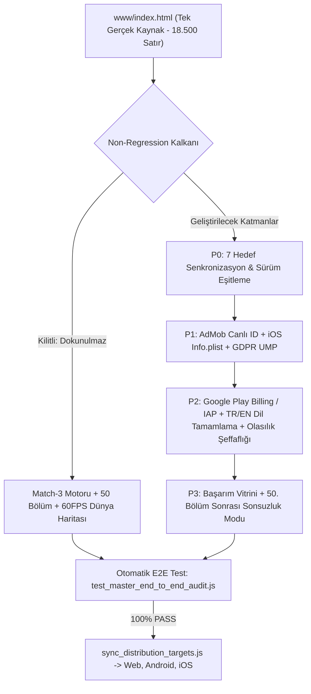

# 🏛️ ARKENYA: MYTHIC JEWELS — MASTER GELİŞTİRME VE YAYIN PLANI

**Doküman Sürümü:** 2.0 (Birleştirilmiş Master Plan)  
**Hedef Sürüm:** `v1.0.11` (`versionCode 18`) → `v1.1.0` (Tam Mağaza Sürümü)  
**Birincil Kaynak (Single Source of Truth):** [www/index.html](file:///c:/Users/sballuca/Desktop/Works/Bogaziciyonetim/Develop/AndroidProjects/Arkenya-main/Arkenya-main/Mythic_Jewels_LLM_Project/www/index.html) (`952.536 bayt`, `18.500 satır`)

---

> [!IMPORTANT]
> **DOKUNULMAZLIK VE KORUMA PROTOKOLÜ (NON-REGRESSION GUARDRAILS)**
> Bu plandaki hiçbir geliştirme adımı, mevcut **Match-3 Oyun Motoru** ve **60FPS Dünya Haritası & Duraklar** mimarisini değiştirmeyecek veya bozmayacaktır. Aşağıdaki 5 çekirdek yapı **KİLİTLİ (FROZEN)** kabul edilir:
> 1. **Harita 60FPS GPU ve Kaydırma Dinamiği:** [`openWorldMap`](file:///c:/Users/sballuca/Desktop/Works/Bogaziciyonetim/Develop/AndroidProjects/Arkenya-main/Arkenya-main/Mythic_Jewels_LLM_Project/www/index.html#L11089), [`jumpToZone`](file:///c:/Users/sballuca/Desktop/Works/Bogaziciyonetim/Develop/AndroidProjects/Arkenya-main/Arkenya-main/Mythic_Jewels_LLM_Project/www/index.html#L11032), [`navigateMapZone`](file:///c:/Users/sballuca/Desktop/Works/Bogaziciyonetim/Develop/AndroidProjects/Arkenya-main/Arkenya-main/Mythic_Jewels_LLM_Project/www/index.html#L10998), [`toggleZoneThemeDrawer`](file:///c:/Users/sballuca/Desktop/Works/Bogaziciyonetim/Develop/AndroidProjects/Arkenya-main/Arkenya-main/Mythic_Jewels_LLM_Project/www/index.html#L10842) ve `__worldMapStateSignature` DOM önbelleklemesi korunacaktır.
> 2. **Durak Konumları ve Önizleme Kartı:** `86px` durak adımı, `110px` bölge koridoru, [`openLevelPreview`](file:///c:/Users/sballuca/Desktop/Works/Bogaziciyonetim/Develop/AndroidProjects/Arkenya-main/Arkenya-main/Mythic_Jewels_LLM_Project/www/index.html#L12101) (`#modal-level-preview`) ve [`renderWoodenStageCards`](file:///c:/Users/sballuca/Desktop/Works/Bogaziciyonetim/Develop/AndroidProjects/Arkenya-main/Arkenya-main/Mythic_Jewels_LLM_Project/www/index.html#L11280) Lazy Render yapısı değiştirilmeyecektir.
> 3. **Match-3 Çekirdek Motoru ve Bölüm Dengesi:** 8x8 grid fiziği, 4'lü/5'li özel taşlar, [`LEVEL_DATA`](file:///c:/Users/sballuca/Desktop/Works/Bogaziciyonetim/Develop/AndroidProjects/Arkenya-main/Arkenya-main/Mythic_Jewels_LLM_Project/www/index.html#L10052) (Bölüm 1–50 hedef/hamle dengesi), [`startGameplay`](file:///c:/Users/sballuca/Desktop/Works/Bogaziciyonetim/Develop/AndroidProjects/Arkenya-main/Arkenya-main/Mythic_Jewels_LLM_Project/www/index.html#L12660) ve 6 kahraman yeteneği korunacaktır.
> 4. **Hızlı Takviye ve Kayıt Sistemi:** [`switchQuickBuyGod`](file:///c:/Users/sballuca/Desktop/Works/Bogaziciyonetim/Develop/AndroidProjects/Arkenya-main/Arkenya-main/Mythic_Jewels_LLM_Project/www/index.html#L14794) (`#modal-quick-booster-buy`) ve [`arkenya_save_v11`](file:///c:/Users/sballuca/Desktop/Works/Bogaziciyonetim/Develop/AndroidProjects/Arkenya-main/Arkenya-main/Mythic_Jewels_LLM_Project/www/index.html#L8350) / `arkenya_active_match` kayıt şeması geriye dönük %100 uyumlu kalacaktır.
> 5. **Otomatik Regresyon Kalkanı:** Her faz sonunda [test_master_end_to_end_audit.js](file:///c:/Users/sballuca/Desktop/Works/Bogaziciyonetim/Develop/AndroidProjects/Arkenya-main/Arkenya-main/Mythic_Jewels_LLM_Project/test_master_end_to_end_audit.js) ve [test_worldmap_and_stages.js](file:///c:/Users/sballuca/Desktop/Works/Bogaziciyonetim/Develop/AndroidProjects/Arkenya-main/Arkenya-main/Mythic_Jewels_LLM_Project/test_worldmap_and_stages.js) çalıştırılarak tüm testlerin `%100 PASS` olduğu doğrulanacaktır.

---

## 📊 MİMARİ AKIŞ VE KORUMA DİYAGRAMI

---

## 🔴 ÖNCELİK 0 (P0 — KRİTİK & ACİL): DAĞITIM SENKRONİZASYONU VE SÜRÜM BÜTÜNLÜĞÜ
*Oyun veya harita koduna dokunmadan, mevcut en güncel sürümün veri kaybına uğramasını önleyen temel altyapı adımları.*

### P0.1 — 7 Dağıtım Hedefinin Bit-Perfect Eşitlenmesi
- **Mevcut Sorun:** [www/index.html](file:///c:/Users/sballuca/Desktop/Works/Bogaziciyonetim/Develop/AndroidProjects/Arkenya-main/Arkenya-main/Mythic_Jewels_LLM_Project/www/index.html), Android ve iOS `public/index.html` dosyaları `952.536 bayt` (`SHA-256: 9a68bd95fb4b`) iken; kök dizindeki [index.html](file:///c:/Users/sballuca/Desktop/Works/Bogaziciyonetim/Develop/AndroidProjects/Arkenya-main/Arkenya-main/Mythic_Jewels_LLM_Project/index.html) ve 4 adet `Arkenya_Playable_Demo.html` dosyası `943.142 bayt` (`SHA-256: 6bc95d5cd202`) seviyesinde eski kalmıştır.
- **Yapılacak İşlem:** [sync_distribution_targets.js](file:///c:/Users/sballuca/Desktop/Works/Bogaziciyonetim/Develop/AndroidProjects/Arkenya-main/Arkenya-main/Mythic_Jewels_LLM_Project/sync_distribution_targets.js) çalıştırılarak tüm 7 hedefin [www/index.html](file:///c:/Users/sballuca/Desktop/Works/Bogaziciyonetim/Develop/AndroidProjects/Arkenya-main/Arkenya-main/Mythic_Jewels_LLM_Project/www/index.html) ile birebir aynı SHA-256 özetine sahip olması sağlanacak.
- **Oyun/Harita Etkisi:** Sıfır risk. Yalnızca eski kalmış kopyalar en güncel çalışan harita/oyun sürümüne yükseltilir.

### P0.2 — `package.json` ve `build.gradle` Sürüm Eşitlemesi
- **Mevcut Sorun:** [android/app/build.gradle](file:///c:/Users/sballuca/Desktop/Works/Bogaziciyonetim/Develop/AndroidProjects/Arkenya-main/Arkenya-main/Mythic_Jewels_LLM_Project/android/app/build.gradle#L10-L11) içinde `versionCode 18` ve `versionName "1.0.11"` tanımlıyken, [package.json](file:///c:/Users/sballuca/Desktop/Works/Bogaziciyonetim/Develop/AndroidProjects/Arkenya-main/Arkenya-main/Mythic_Jewels_LLM_Project/package.json#L7) içinde `"version": "1.0.9"` yazmaktadır.
- **Yapılacak İşlem:** [package.json](file:///c:/Users/sballuca/Desktop/Works/Bogaziciyonetim/Develop/AndroidProjects/Arkenya-main/Arkenya-main/Mythic_Jewels_LLM_Project/package.json) sürümü `"1.0.11"` yapılacak; `"scripts"` altına `"sync:targets": "node sync_distribution_targets.js"` ve `"audit:e2e": "node test_master_end_to_end_audit.js"` komutları eklenecek.

### P0.3 — Atıl/Yetim Dosyaların ve Eski Betiklerin Yalıtılması
- **Mevcut Sorun:** Kök dizinde kullanılmayan `firebase.json`, `firestore.rules` ve 100+ adet eski tek seferlik `apply_*.js` / `fix_*.js` betiği bulunmaktadır.
- **Yapılacak İşlem:** Çalışan oyun dosyalarına ve aktif test süitlerine (`test_*.js`, `sync_*.js`) dokunulmadan, yalnızca görevini tamamlamış eski yama betikleri `scripts/archive/` klasörüne taşınacak ve atıl Firebase yapılandırma dosyaları temizlenecek.

---

## 🟠 ÖNCELİK 1 (P1 — YÜKSEK): CANLI REKLAM, iOS ADMOB VE MAĞAZA UYUMLULUĞU
*Mevcut `window.AdGuard` köprüsünün oyun akışını kesintiye uğratmadan canlı mağaza standartlarına tamamlanması.*

### P1.1 — Canlı Android Interstitial ve iOS AdMob Birim Kimlikleri
- **Mevcut Durum:** [`window.AdGuard`](file:///c:/Users/sballuca/Desktop/Works/Bogaziciyonetim/Develop/AndroidProjects/Arkenya-main/Arkenya-main/Mythic_Jewels_LLM_Project/www/index.html#L17962) içinde 3 Android ödüllü reklam (`rewarded`, `rewardedExtraMove`, `rewardedCoins`) canlı ID'ye sahipken, `interstitial.android` ve tüm `ios` kimlikleri Google test ID'si (`ca-app-pub-3940256099942544/...`) kullanmaktadır.
- **Yapılacak İşlem:**
  1. AdMob panelinden alınacak canlı Android Interstitial ID ve iOS Ad Unit ID'leri [`window.AdGuard.adUnitIds`](file:///c:/Users/sballuca/Desktop/Works/Bogaziciyonetim/Develop/AndroidProjects/Arkenya-main/Arkenya-main/Mythic_Jewels_LLM_Project/www/index.html#L17969-L17986) nesnesine işlenecek.
  2. [ios/App/App/Info.plist](file:///c:/Users/sballuca/Desktop/Works/Bogaziciyonetim/Develop/AndroidProjects/Arkenya-main/Arkenya-main/Mythic_Jewels_LLM_Project/ios/App/App/Info.plist) dosyasına `GADApplicationIdentifier` ve `SKAdNetworkItems` blokları eklenecek.
- **Oyun/Harita Etkisi:** Sıfır. Mevcut 2.5 dakika geçiş reklamı koruması (`interstitialCooldownMs: 150000`), VIP Pass anında ödül bypass mantığı ve 6 saniyelik watchdog zamanlayıcısı aynen korunur.

### P1.2 — AB / İngiltere Kullanıcıları İçin Google UMP (GDPR) Onay Formu
- **Mevcut Sorun:** [AD_MONETIZATION_PLAN.md](file:///c:/Users/sballuca/Desktop/Works/Bogaziciyonetim/Develop/AndroidProjects/Arkenya-main/AD_MONETIZATION_PLAN.md#L126) kapsamında belirtilen Google UMP rıza kontrolü henüz `AdGuard` başlatıcısına bağlanmamıştır.
- **Yapılacak İşlem:** [`window.AdGuard.init`](file:///c:/Users/sballuca/Desktop/Works/Bogaziciyonetim/Develop/AndroidProjects/Arkenya-main/Arkenya-main/Mythic_Jewels_LLM_Project/www/index.html#L17988) içerisine, yalnızca native Capacitor ortamında ve AB/UK bölgesinde tetiklenen güvenli (`try/catch` korumalı, oyunu bloklamayan) `AdMob.requestConsentInfo()` kontrolü eklenecek.

### P1.3 — Kapalı Testten Açık Üretime Geçişte IAP / Billing Köprüsü
- **Mevcut Durum:** [AndroidManifest.xml](file:///c:/Users/sballuca/Desktop/Works/Bogaziciyonetim/Develop/AndroidProjects/Arkenya-main/Arkenya-main/Mythic_Jewels_LLM_Project/android/app/src/main/AndroidManifest.xml#L52-L53) içinde `com.android.vending.BILLING` izni kapalı test süreci için pasif tutulmaktadır.
- **Yapılacak İşlem:**
  1. Kapalı test aşamasında mevcut sanal ekonomi korunacak; açık üretime geçişte `BILLING` izni aktif edilerek `🚫 Reklamsız Macera Pass` ve Elmas paketleri için opsiyonel Native Billing kancası (`window.BillingBridge`) eklenecek.
  2. Apple App Store ve Google Play zorunluluğu olan **"Satın Alımları Geri Yükle (Restore Purchases)"** butonu `#modal-settings` içerisine eklenecek.

---

## 🟡 ÖNCELİK 2 (P2 — ORTA): YERELLEŞTİRME (TR/EN) VE MAĞAZA ŞEFFAFLIĞI
*Mevcut DOM yapısını, CSS sınıflarını ve harita/oyun mekaniklerini değiştirmeden yalnızca metin ve bilgi katmanının zenginleştirilmesi.*

### P2.1 — Sabit Türkçe Metinlerin TR/EN Dil Sözlüğüne (`i18n`) Bağlanması
- **Mevcut Sorun:** Ayarlar modalında dil değiştirme seçeneği bulunsa da son eklenen harita bilgi çekmecesi, önizleme kartı rozetleri ve hızlı takviye modalındaki bazı metinler doğrudan Türkçe yazılmıştır.
- **Yapılacak İşlem:** DOM ID'lerine veya buton `onclick` olaylarına dokunmadan, dil değişim fonksiyonuna bu alanların İngilizce karşılıkları eklenecek.

### P2.2 — Sandık ve Şans Ödülleri Olasılık Şeffaflığı (Drop Rates Disclosure)
- **Mevcut Sorun:** [COMPLIANCE.md](file:///c:/Users/sballuca/Desktop/Works/Bogaziciyonetim/Develop/AndroidProjects/Arkenya-main/Arkenya-main/Mythic_Jewels_LLM_Project/11_STORE_COMPLIANCE/COMPLIANCE.md#L18) gereği mağaza ve günlük sandık ödüllerinin yüzdesel çıkma olasılıkları kullanıcıya şeffafça gösterilmelidir.
- **Yapılacak İşlem:** Mağaza ekranındaki sandık bölümüne küçük bir `ℹ️ Olasılıklar` bilgisi eklenerek Ahşap, Gümüş ve Mitik sandıkların altın/elmas/joker yüzdeleri listelenecek.

---

## 🟢 ÖNCELİK 3 (P3 — UZUN VADE / v1.2+): BAŞARIMLAR VE BÖLÜM SONU TUTUNDURMA
*50 bölümü tamamlayan oyuncuları oyunda tutacak, mevcut `LEVEL_DATA[1..50]` yapısına dokunmayan ek meta sistemler.*

### P3.1 — Olimpos Başarım Vitrini (Achievements)
- **Kapsam:** [SYSTEMS_SPEC.md](file:///c:/Users/sballuca/Desktop/Works/Bogaziciyonetim/Develop/AndroidProjects/Arkenya-main/Arkenya-main/Mythic_Jewels_LLM_Project/06_GAMEPLAY_SYSTEMS/SYSTEMS_SPEC.md#L55-L60) içinde tanımlanan 5 temel başarımın (*İlk Zafer*, *Kombo Ustası*, *Boss Avcısı*, *Üç Yıldız Kahramanı*, *Dünya Kaşifi*) mevcut `gameState` istatistiklerinden okunarak oyuncu profilinde gösterilmesi ve tek seferlik elmas ödülü vermesi.

### P3.2 — 50. Bölüm Sonrası "Altın Prestij / Olimpos Kulesi" Tekrar Oynanabilirlik Modu
- **Kapsam:** Mevcut 50 durağın harita dizilimine dokunmadan, 50. bölümdeki Zeus Boss'u yenildiğinde açılan ve mevcut bölümleri yüksek yıldız/skor hedefleriyle tekrar oynatıp ekstra lig puanı kazandıran **Prestij Döngüsü**.

---

## ✅ UYGULAMA VE ONAY KONTROL LİSTESİ

| Sıra | Faz Kodu | Görev Tanımı | Oyun/Harita Riski | Doğrulama Aracı |
| :---: | :---: | :--- | :---: | :--- |
| **1** | **P0.1** | 7 dağıtım hedefinin (`index.html`, Demo, Android, iOS) [www/index.html](file:///c:/Users/sballuca/Desktop/Works/Bogaziciyonetim/Develop/AndroidProjects/Arkenya-main/Arkenya-main/Mythic_Jewels_LLM_Project/www/index.html) ile eşitlenmesi | %0 (Sıfır Risk) | `sync_distribution_targets.js` |
| **2** | **P0.2** | [package.json](file:///c:/Users/sballuca/Desktop/Works/Bogaziciyonetim/Develop/AndroidProjects/Arkenya-main/Arkenya-main/Mythic_Jewels_LLM_Project/package.json) sürümünün `1.0.11` yapılması ve npm scriptlerinin eklenmesi | %0 (Sıfır Risk) | `test_master_end_to_end_audit.js` |
| **3** | **P0.3** | Atıl Firebase dosyalarının ve eski `apply_*/fix_*` betiklerinin arşivlenmesi | %0 (Sıfır Risk) | `test_worldmap_and_stages.js` |
| **4** | **P1.1** | Canlı Interstitial & iOS AdMob ID'lerinin ve `Info.plist` ayarlarının girilmesi | %0 (Yalnızca Konfigürasyon) | `npx cap sync` |
| **5** | **P1.2** | `window.AdGuard.init()` içine Google UMP (GDPR) onay kontrolünün eklenmesi | %0 (Try/Catch Yalıtımlı) | `test_master_end_to_end_audit.js` |
| **6** | **P1.3** | Ayarlar menüsüne "Satın Alımları Geri Yükle" ve opsiyonel Billing köprüsü eklenmesi | %0 (Yeni UI Butonu) | `test_playstore_readiness_and_ui.js` |
| **7** | **P2.1** | Sabit Türkçe metinlerin TR/EN dil sözlüğüne (`i18n`) bağlanması | %0 (Salt Metin Sözlüğü) | `test_master_end_to_end_audit.js` |
| **8** | **P2.2** | Mağaza sandıklarına `ℹ️ Olasılıklar` (Drop Rates) şeffaflık bilgisinin eklenmesi | %0 (Salt Bilgi Görünümü) | `test_store_boosters_and_economy.js` |
| **9** | **P3.1** | 5 Olimpos Başarım rozetinin (`Achievements`) profil/lig ekranına eklenmesi | %0 (Salt Okunur İstatistik) | `test_master_end_to_end_audit.js` |
| **10** | **P3.2** | 50. Bölüm sonrası Prestij Turu / Sonsuzluk görevinin tanımlanması | %0 (`LEVEL_DATA[1..50]` Kilitli) | `simulate_full_progression.js` |
